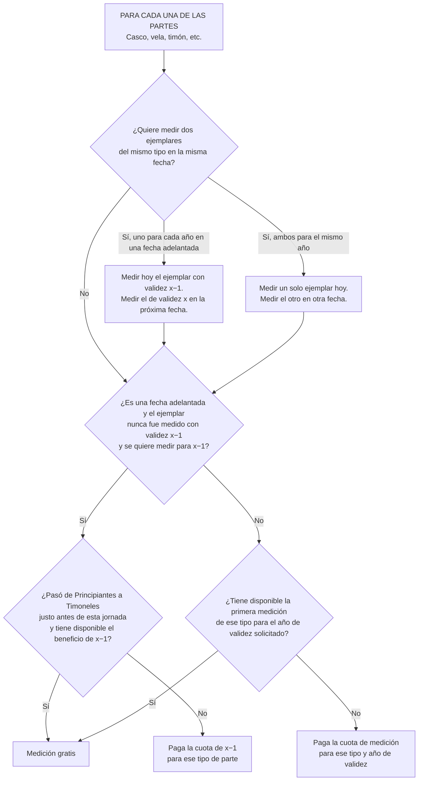

import Link from "fumadocs-core/link";
import { Tab, Tabs } from "fumadocs-ui/components/tabs";
import { ExternalLink } from "lucide-react";

Rol/es autorizados

`👨‍👩‍👧 Entrenadores` | `🧑🏻‍💻 Staff AOA`

## Fechas adelantadas

Una fecha adelantada es una jornada realizada a fines del año x−1 en la que ya se puede medir con validez para el año x. Quien pasa de Principiantes a Timoneles tiene el beneficio de primera medición en el año del cambio. Si el cambio ocurre justo antes de esa jornada, puede tener disponibles tanto el beneficio de x−1 como el de x.

#### Ejemplo:

Para el año 2027 (año x) se programa una fecha de medición en noviembre de 2026. (2026 es el año x-1)

### Diagrama de opciones

### Cuadro de situaciones

| Situación                                                                                              | Qué se mide y qué se cobra                                                                                                              |
| ------------------------------------------------------------------------------------------------------ | --------------------------------------------------------------------------------------------------------------------------------------- |
| Quiere medir una vela nunca medida con validez **x−1** para ese mismo año.                             | Paga la cuota de la vela de **x−1**, salvo que le corresponda la excepción por cambio de categoría.                                     |
| Pasó a Timoneles justo antes de la jornada y quiere medir un casco para **x−1** y una vela para **x**. | Puede medir ambos ese día. Con los dos beneficios disponibles, ambas mediciones son gratis.                                             |
| Quiere medir dos velas, una para **x−1** y otra para **x**.                                            | Mide primero la vela para **x−1** y deja la de **x** para la próxima fecha. Se evalúa la gratuidad de cada una según su año de validez. |
| Ya usó el beneficio de vela para **x** y quiere medir otra vela para **x**.                            | Paga la cuota de medición de vela de **x** y respeta el límite de una vela por fecha.                                                   |
